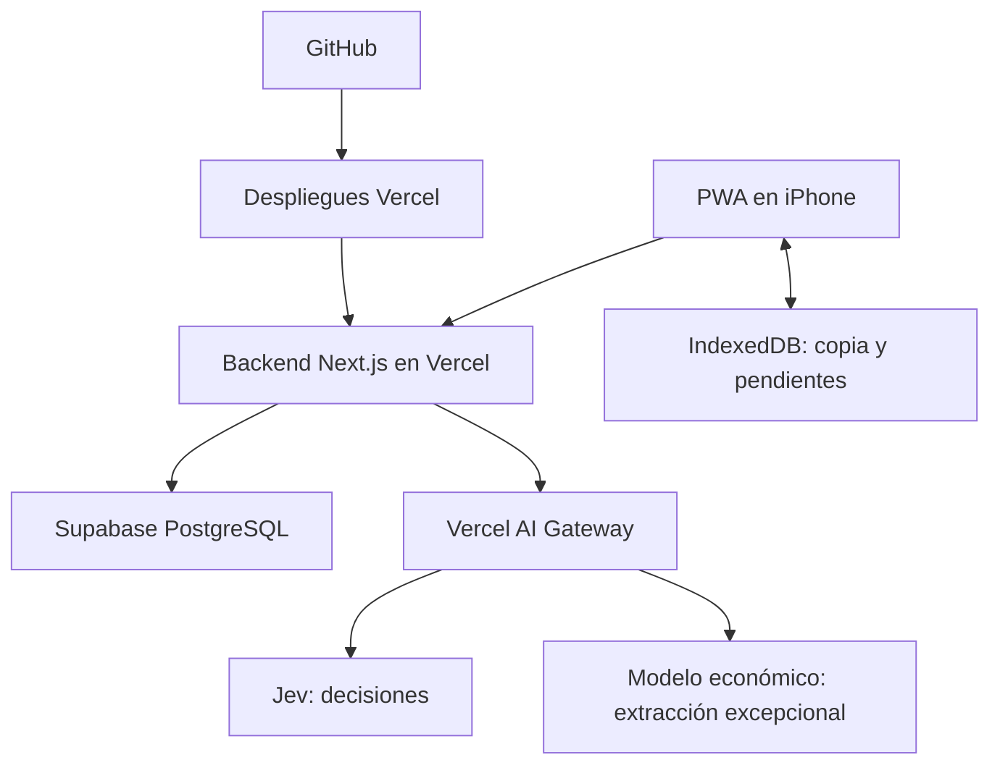

# 04 · Arquitectura, API y despliegue

## Componentes



La interfaz, API y PWA se publican juntas. PostgreSQL almacena todos los datos compartidos; no guardar inventario en archivos locales de funciones de Vercel. No es necesario un servidor permanente ni un worker de larga duración para v1.

## Organización propuesta del código

- `app/`: pantallas, layouts y handlers HTTP.
- `src/domain/`: tipos, validaciones, estados y preparación de comandos.
- `src/server/`: sesiones, repositorios, servicio de comandos, búsqueda, importación y exportación.
- `src/ai/`: adaptadores Jev/generación, instrucciones versionadas, presupuesto y evaluación.
- `src/offline/`: IndexedDB, cola, reconciliación y migraciones locales.
- `src/components/`: chat, tarjetas, formularios y estados de sincronización.
- `supabase/migrations/`: esquema, restricciones, RPC, roles e índices.
- `tests/`: pruebas de dominio, integración, navegador y datos de evaluación.

No usar el contenido de `docs/references` como base de datos viva ni importar automáticamente esos archivos al arrancar la app.

## Acceso y sesiones

Una invitación aleatoria de al menos 128 bits permite incorporarse al grupo. El enlace puede transportar el token en el fragmento de URL; el cliente lo intercambia mediante POST y elimina el fragmento. Evitar incluir el token en logs o enlaces compartidos a fichas.

El servidor entrega una cookie opaca `HttpOnly`, `Secure`, `SameSite=Lax` con expiración propuesta de 30 días. Guardar hash del token de sesión. La invitación se configura por hash en servidor y se puede rotar; la rotación no debe borrar el inventario. No utilizar el nombre elegido como secreto.

Después de validar la invitación, se pueden listar/seleccionar participantes de la mudanza. Cambiar de participante es explícito y actualiza la sesión. Los colaboradores tienen las mismas capacidades de inventario en v1; el presupuesto y configuración del proveedor se gestionan fuera de los flujos normales.

Una sesión recién invitada puede leer la información necesaria para elegir participante. Los comandos mutadores y el chat requieren completar esa selección. Las operaciones offline guardan el participante esperado: si la sesión cambió de nombre antes de sincronizar, pedir resolver la atribución en lugar de aceptar un actor arbitrario del cliente.

La atribución es por nombre elegido y sesión; no constituye autenticación fuerte de identidad. Esto satisface el uso familiar solicitado y protege la API de escritura y gasto frente a peticiones sin invitación.

## Acceso a PostgreSQL

- Todas las lecturas y escrituras de aplicación pasan por el backend y una sesión válida.
- RLS habilitado y permisos sin acceso público a tablas de inventario. No exponer una clave privilegiada al navegador.
- Cliente de Supabase privilegiado exclusivamente en servidor. Dado que puede omitir RLS, cada operación comprueba obligatoriamente `move_id` obtenido de la sesión, incluidos búsquedas, exportaciones y UUID anidados.
- Revocar ejecución pública de las RPC privilegiadas. La función transaccional valida todas las relaciones; el backend entrega identidad ya validada.
- Se puede usar una credencial de servidor admitida por el SDK vigente. Confirmar en T01 el nombre/formato disponible en Supabase; no confundir la clave publicable con una clave privilegiada.
- No sumar login de Supabase o Realtime solamente para distribuir eventos; v1 sincroniza por backend y revisión.

## Catálogo de comandos

Las fichas y el chat usan el mismo catálogo:

| Comando | Efecto |
| --- | --- |
| `create_unit` | Crear unidad con UUID del cliente y etiqueta asignada/reservada. |
| `update_unit` | Cambiar campos permitidos: nombre, destino, notas, fragilidad, prioridad, tamaño. |
| `append_content` | Agregar entrada conservando su texto de origen. |
| `edit_content` | Corregir una entrada con versión esperada. |
| `split_content` | Separar una entrada para editar/retirar solo una parte, preservando procedencia. |
| `transfer_content` | Mover entrada a otro contenedor abierto; transacción sobre ambos. |
| `unpack_content` | Marcar retiro y ubicación nueva solo si fue indicada. |
| `close_unit` / `reopen_unit` | Cambiar empaque con autor, hora y validaciones. |
| `set_transit_state` | Registrar carga/llegada o corrección explícita. |
| `set_unpack_state` | Registrar desempaque, con efecto sobre entradas según 02-datos. |
| `split_unit_group` | Dividir cantidad de un lote conservando suma y procedencia. |
| `link_accessory` / `unlink_accessory` | Vincular entrada con mueble/objeto al que pertenece. |
| `archive_unit` / `restore_unit` | Archivo lógico y restauración. |
| `archive_content` / `restore_content` | Retirar un registro erróneo del inventario activo sin borrar su historial. |
| `undo_event` | Compensar un evento compatible con versiones actuales. |
| `compound` | Lista limitada de comandos simples, ejecutada de forma atómica. |

Un comando no puede cambiar arbitrariamente actor, mudanza, historial o uso de IA. Limitar compuestos a 20 acciones en v1; operaciones masivas mayores se dividen en lotes visibles con confirmación por lote.

## Endpoints

Los nombres son el contrato inicial. Si se cambia una ruta, actualizar cliente, pruebas y este documento en la misma tarea.

| Método y ruta | Contrato |
| --- | --- |
| `POST /api/session` | Intercambiar invitación por sesión. No llamar a modelos. |
| `PATCH /api/session/participant` | Seleccionar/crear participante y recordar la identidad. |
| `DELETE /api/session` | Salir y limpiar los datos locales de esa sesión cuando corresponda. |
| `GET /api/bootstrap` | Mudanza, ambientes, participantes disponibles y configuración pública de capacidades. |
| `GET /api/inventory/snapshot` | Inventario coherente completo, con revisión y fecha del servidor. |
| `GET /api/sync?after=REV&limit=N` | Cambios ordenados por revisión, tombstones lógicos, siguiente cursor y `hasMore`. |
| `GET /api/units` | Lista filtrada/paginada, sin IA. |
| `GET /api/units/:id` | Ficha, contenido actual, historial resumido y versiones. |
| `GET /api/units/:id/events` | Historial paginado de la unidad, con actor y cambios. |
| `GET /api/search?q=...` | Búsqueda determinista sin costo de IA. |
| `POST /api/search/semantic` | Búsqueda con Jev, bajo presupuesto; devuelve evidencia y alcance. |
| `POST /api/commands` | Ejecutar comando idempotente. |
| `GET /api/commands/:operationId` | Recuperar recibo ante respuesta perdida. |
| `POST /api/labels/reserve` | Reservar lote pequeño de etiquetas por dispositivo/prefijo, idempotentemente. |
| `POST /api/chat/messages` | Procesar texto con contexto y UUID; devolver respuesta persistida o estado en proceso. |
| `POST /api/conversations` | Crear idempotentemente una conversación con UUID del cliente y propiedad de sesión/dispositivo. |
| `PATCH /api/conversations/:id/context` | Cambiar explícitamente unidad activa con versión esperada del contexto. |
| `GET /api/chat/messages/:messageId` | Recuperar estado/respuesta del mismo mensaje. |
| `GET /api/conversations/:id/messages` | Historial de la conversación autorizada. |
| `POST /api/chat/messages/:id/resolve` | Resolver opciones/confirmaciones ligadas a la propuesta original y sus versiones. |
| `POST /api/imports/preview` | Validar fuente y producir revisión sin crear unidades. |
| `POST /api/imports/:id/commit` | Aplicar filas aprobadas idempotentemente. |
| `GET /api/exports?format=json|csv` | Exportar con snapshot coherente y versión de esquema. |
| `GET /api/usage` | Resumen de costo/reserva/límite sin secretos. |

Las llamadas que consumen IA no se ejecutan por prefetch ni por un GET automático del navegador. Validar `Origin`/CSRF en operaciones mutadoras, límites de cuerpo y rate limits persistentes. Default propuesto: 10 solicitudes de IA por minuto por sesión y 30 por minuto por mudanza, además del presupuesto total. Ajustar con pruebas de uso real; no depender de memoria de una función serverless para imponer el límite.

### Ejemplo de comando

```json
{
  "operationId": "UUID-persistido-por-el-cliente",
  "type": "close_unit",
  "payload": { "unitId": "UUID-de-C-024" },
  "expectedVersions": { "UUID-de-C-024": 7 }
}
```

Los UUID del ejemplo son marcadores explicativos; la implementación valida UUID reales. El servidor deriva actor y mudanza. La respuesta incluye `status`, `operationId`, `revision`, entidades actualizadas, `eventId` y recibo. Un segundo envío idéntico devuelve el recibo original.

### Mensajes y propuestas

Entrada: `messageId`, `conversationId`, `text`, `activeUnitId`, `contextVersion` e idioma opcional. El contexto del cliente se valida y se conserva como el que existía al enviar; no se reemplaza por “la última caja creada por cualquiera”.

Estados de respuesta: `processing`, `answered`, `applied`, `needs_clarification`, `needs_confirmation`, `failed`. La respuesta diferencia `replyMode=template|generated` y guarda evidencia estructurada; la UI no necesita exponer esos detalles técnicos.

Las propuestas de confirmación tienen ID, plan validado, versiones, resumen y vencimiento propuesto de 10 minutos. Confirmar exige releer versiones. Un plan vencido o modificado se recalcula y presenta otra vez; nunca se ejecuta sobre referencias ambiguas.

Errores: `400` inválido, `401` sin sesión, `403` fuera de ámbito, `404` no encontrado, `409` conflicto/idempotencia, `422` regla de dominio no cumplida, `429` límite, `503` proveedor/servicio temporalmente no disponible. Presupuesto agotado usa un código de aplicación específico en una respuesta válida y ofrece alternativa manual. No interpretar un error de proveedor como “objeto no encontrado”.

## Sincronización

El snapshot devuelve datos y revisión del mismo estado transaccional. Los deltas incluyen unidades/entradas cambiadas y archivos lógicos; las relaciones se aplican consistentemente. El cliente avanza su cursor solo después de persistir todo el lote en IndexedDB.

Leer cambios al iniciar, al volver al primer plano, después de escribir y cada 10 segundos mientras la app está visible y online. Pausar polling al ocultarse; no depender de ejecución en background de iOS. Evitar polling simultáneo redundante entre pestañas del mismo dispositivo.

## Configuración propuesta

| Variable | Naturaleza y propósito |
| --- | --- |
| `SUPABASE_URL` | URL del proyecto, utilizada por servidor. |
| `SUPABASE_SECRET_KEY` | Credencial privilegiada de servidor, o nombre equivalente documentado si el proyecto utiliza formato legacy. |
| `AI_GATEWAY_API_KEY` | Secreto para Gateway cuando no se usa identidad OIDC compatible de Vercel. |
| `INVITE_TOKEN_HASH` | Hash de invitación vigente; el enlace original se entrega al organizador fuera del repositorio. |
| `APP_BASE_URL` | Origen autorizado y base de enlaces de fichas. |
| `DECISION_MODEL` | Identificador de Jev verificado en Gateway. |
| `GENERATION_MODEL` | Modelo de extracción elegido en T00. Ausente/deshabilitado implica aclaración/formulario; no una llamada oculta a otro proveedor. |
| `AI_BUDGET_USD` | Default 5 para producción; menor para pruebas. |
| `AI_ENABLED` / `GENERATION_ENABLED` | Interruptores independientes de operaciones de IA. |
| `APP_ENV` | Desarrollo, preview o producción; controla datos y presupuestos separados. |

Las claves jamás van en `NEXT_PUBLIC_*`, logs, fixtures o archivos de especificación. Crear `.env.example` con nombres y valores no secretos durante T01. Verificar bindings existentes antes de pedir credenciales nuevas. No configurar servicios reales durante una tarea que solo crea UI o pruebas con mocks.

## GitHub y Vercel

- Conectar el repositorio a Vercel; rama de producción `main`.
- Push a rama/PR: preview. Merge/push autorizado a `main`: producción.
- CI requerida: tipos, lint, pruebas relevantes y build. Agregar integración de PostgreSQL y E2E a medida que existan.
- Previews usan otro proyecto de Supabase o fixtures/modo demo aislado. Nunca heredan credenciales de producción para modificar el inventario real.
- Migraciones versionadas y revisadas. Ensayarlas en datos de prueba antes de producción. Priorizar cambios compatibles con clientes que todavía usan la versión anterior de la PWA.
- No aplicar migraciones destructivas ni importar automáticamente por cada deploy. La carga de los 17 ambientes es idempotente; los muebles requieren revisión.
- Un rollback de Vercel no revierte la base de datos. Documentar compatibilidad de esquema y recuperación.
- Vercel Hobby y Supabase Free son objetivos de costo; verificar límites y condiciones vigentes antes del lanzamiento. No depender de créditos promocionales para que el inventario siga disponible.

## Operación mínima

Registrar errores, latencia, revisiones y códigos de operación sin transcripciones completas en logs de infraestructura. Los mensajes necesarios para el historial viven en tablas con acceso de sesión, no en trazas públicas.

La aplicación debe indicar indisponibilidad de base de datos frente a indisponibilidad de IA. La primera impide confirmar guardado compartido; la segunda permite continuar con controles manuales. Preparar una exportación antes del día de mudanza y repetir el smoke test multiusuario en iPhone.
