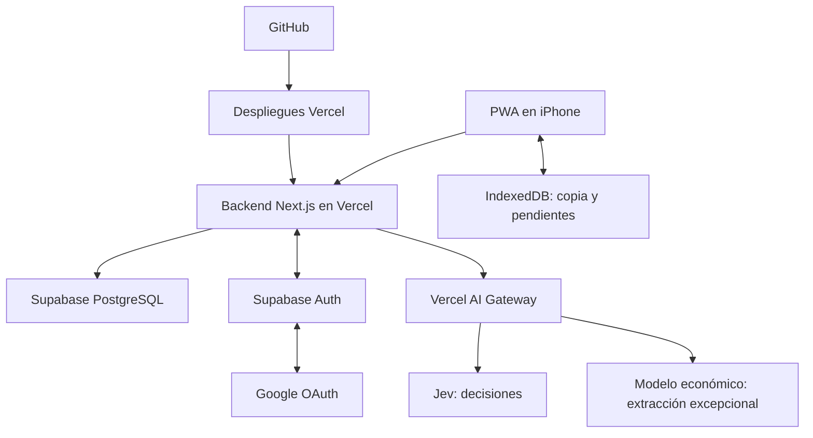

# 04 · Arquitectura, API y despliegue

## Componentes



La interfaz, API y PWA se publican juntas. PostgreSQL almacena todos los datos compartidos; no guardar inventario en archivos locales de funciones de Vercel. Supabase aporta base de datos y Google Login; no se agrega Neon ni Auth.js. No es necesario un servidor permanente ni un worker de larga duración para v1.

## Organización propuesta del código

- `app/`: pantallas, layouts y handlers HTTP.
- `src/domain/`: tipos, validaciones, estados y preparación de comandos.
- `src/server/`: sesiones, repositorios, servicio de comandos, búsqueda, importación y exportación.
- `src/ai/`: adaptadores Jev/generación, instrucciones versionadas, presupuesto y evaluación.
- `src/offline/`: IndexedDB, cola, reconciliación y migraciones locales.
- `src/components/`: chat, tarjetas, formularios y estados de sincronización.
- `supabase/migrations/`: esquema, restricciones, RPC, roles e índices.
- `tests/`: pruebas de dominio, integración, navegador y datos de evaluación.

No usar el contenido de `docs/references` como base de datos viva ni importar automáticamente esos archivos al arrancar la app.

## Acceso y sesiones

### Google OAuth y sesión de Supabase

Usar `@supabase/supabase-js` y `@supabase/ssr`, con versiones compatibles fijadas en T01/T03. Flujo de redirección OAuth con PKCE, iniciado por una acción explícita “Continuar con Google”. El backend inicia el flujo y canjea el código; no usar popup obligatorio ni Google One Tap para v1.

1. `POST /api/auth/google` valida origen/CSRF, prepara PKCE con el SDK y redirige a Supabase/Google. Pedir solo `openid`, `email` y `profile`; no persistir tokens de acceso a APIs de Google.
2. Google retorna a `https://<project-ref>.supabase.co/auth/v1/callback`, registrada en su cliente OAuth de tipo Web application. Supabase retorna a `APP_BASE_URL/auth/callback`, registrada en Supabase URL Configuration. Son dos URLs distintas.
3. `GET /auth/callback` canjea el código mediante `exchangeCodeForSession`, valida el usuario con Supabase Auth y resuelve la membresía. Rechazar código inválido/repetido o verificador PKCE ausente; conservar los controles de estado del proveedor/SDK. Un destino posterior solo admite rutas internas validadas, nunca un origen libre enviado por el cliente.
4. Si existe membresía activa, completar la vinculación inicial atómica y entrar. Si no existe, mostrar acceso denegado y cerrar la sesión local de la app sin entregar datos ni llamar a IA. Supabase puede haber creado un usuario Auth; eso no lo convierte en participante autorizado.

Las sesiones y su renovación pertenecen a Supabase Auth; se elimina la sesión opaca propia y la expiración arbitraria de 30 días. T03 documenta la configuración real de sesión elegida. En esta arquitectura el navegador usa nuestra API, no un cliente Auth de Supabase: almacenar la sesión en cookies administradas por `@supabase/ssr`, `HttpOnly`, `Secure` en HTTPS, `SameSite=Lax`, sin compartirlas entre dominios. Validar este flujo íntegramente desde el servidor con la versión fijada del SDK; no mezclarlo con un cliente de navegador que necesite leer esas cookies.

Crear un cliente Auth por petición con la clave publicable y las cookies de esa petición. Renovar tokens en un handler/proxy de Next.js que pueda escribir cookies y propagar todos los `Set-Cookie` y encabezados de caché al navegador, también en redirects/errores. No usar un cliente autenticado mutable global. Respuestas de sesión, callback y datos personales usan `Cache-Control: private, no-store`; sin ISR ni caché compartida de respuestas autenticadas.

Cada entrada protegida del backend valida al usuario con `supabase.auth.getUser()` y resuelve su membresía activa. No confiar únicamente en `getSession()`, cookies decodificadas o metadata editable enviada por el cliente. La identidad Google y el correo verificado usados para la vinculación provienen de Auth, no de un body o apodo. Si Auth está temporalmente caído, no aceptar identidades sin verificar: conservar pendientes y mostrar indisponibilidad.

### Autorización, apodos y salida

La lista de correos autorizados vive en `move_memberships`; los 3–5 colaboradores tienen las mismas capacidades de inventario. T03 entrega una herramienta administrativa idempotente para alta, consulta, desactivación y vinculación explícita con participantes restaurados. Documentar sus comandos en la [guía de configuración](../GUIA-CONFIGURACION.md). No necesita pantalla de administración familiar ni tokens de invitación; no guardar la lista real en Git ni enviarla en bootstrap.

Resolver el actor desde `auth.users.id` → membresía activa → `participants.id`. El apodo propio se edita como perfil, nunca como selección de otra identidad. La revocación de membresía bloquea las siguientes solicitudes protegidas y nuevas mutaciones aun con token vigente; preservar todo el historial. La administración y los comandos deben coordinar locks/revalidación para no confirmar una mutación tras una revocación ya confirmada.

Los comandos y mensajes capturan `expectedParticipantId` al crearse. El servidor lo compara con el actor autenticado antes de ejecutar o recuperar una operación; si no coincide, devuelve `409 ACTOR_MISMATCH` y conserva el pendiente. Es una precondición, no una forma de elegir actor. Cubre también una pestaña que conservó la cuenta anterior mientras otra cambió las cookies de login.

Cerrar sesión llama a Supabase con `scope: 'local'`, limpia las cookies de ese navegador y oculta su copia local siguiendo 05-offline-ios; no cerrar automáticamente otras sesiones del mismo usuario. Cambiar de cuenta permite seleccionar otra cuenta en Google. Las operaciones pendientes quedan ligadas a la mudanza y participante originales: solo se reenvían bajo esa misma cuenta autorizada, nunca se reasignan por cambiar el apodo o aceptar una confirmación genérica.

## Acceso a PostgreSQL

- Todas las lecturas y escrituras de aplicación pasan por el backend y una sesión válida con membresía activa.
- RLS habilitado y sin acceso directo de roles `anon` o `authenticated` a tablas/RPC de inventario o membresías. Tener un JWT de Supabase Auth no habilita la Data API pública. No exponer una clave privilegiada al navegador.
- Acceso de datos privilegiado exclusivamente en servidor y separado del cliente Auth por petición. La implementación inicial usa `node-postgres` contra PostgreSQL de Supabase para transacciones directas equivalentes a RPC; necesita `DATABASE_URL` y TLS. El cliente Data API con `SUPABASE_SECRET_KEY` no está activo. Dado que puede omitir RLS, cada operación comprueba obligatoriamente `move_id` y participante obtenidos de la membresía validada, incluidos búsquedas, exportaciones y UUID anidados.
- Revocar ejecución pública de las RPC privilegiadas. La función transaccional valida todas las relaciones; el backend entrega identidad ya validada.
- Se puede usar una credencial de servidor admitida por el SDK vigente. Confirmar en T01 el nombre/formato disponible en Supabase; no confundir la clave publicable con una clave privilegiada.
- Supabase Auth gestiona el login; Realtime sigue fuera de v1. La sincronización usa backend y revisión.

## Catálogo de comandos

Las fichas y el chat usan el mismo catálogo:

| Comando | Efecto |
| --- | --- |
| `update_own_profile` | Editar solo el apodo del participante autenticado, con versión, idempotencia e historial; no modificar membresías. |
| `create_unit` | Crear unidad con UUID del cliente y etiqueta asignada/reservada. |
| `update_unit` | Cambiar campos permitidos: nombre, destino, notas, fragilidad, prioridad, tamaño. |
| `append_content` | Agregar entrada conservando su texto de origen. |
| `edit_content` | Corregir una entrada con versión esperada. |
| `split_content` | Separar una entrada para editar/retirar solo una parte, preservando procedencia. |
| `transfer_content` | Mover entrada a otro contenedor abierto; transacción sobre ambos. |
| `unpack_content` | Marcar retiro y ubicación nueva solo si fue indicada. |
| `close_unit` / `reopen_unit` | Cambiar empaque con autor, hora y validaciones. |
| `set_transit_state` | Registrar carga/llegada o corrección explícita. |
| `set_unpack_state` | Registrar desempaque, con efecto sobre entradas según 02-datos. |
| `split_unit_group` | Dividir cantidad de un lote conservando suma y procedencia. |
| `link_accessory` / `unlink_accessory` | Vincular entrada con mueble/objeto al que pertenece. |
| `archive_unit` / `restore_unit` | Archivo lógico y restauración. |
| `archive_content` / `restore_content` | Retirar un registro erróneo del inventario activo sin borrar su historial. |
| `undo_event` | Compensar un evento compatible con versiones actuales. |
| `compound` | Lista limitada de comandos simples, ejecutada de forma atómica. |

Un comando no puede cambiar arbitrariamente actor, mudanza, historial o uso de IA. Limitar compuestos a 20 acciones en v1; operaciones masivas mayores se dividen en lotes visibles con confirmación por lote.

## Endpoints

Los nombres son el contrato inicial. Si se cambia una ruta, actualizar cliente, pruebas y este documento en la misma tarea.

| Método y ruta | Contrato |
| --- | --- |
| `POST /api/auth/google` | Iniciar Google OAuth con PKCE y redirección; sin IA. |
| `GET /auth/callback` | Canjear código, validar Google y resolver membresía; sin IA. |
| `POST /api/auth/signout` | Cerrar sesión local de Supabase; el cliente gestiona sus pendientes antes de ocultar/limpiar la copia. |
| `GET /api/bootstrap` | Solo para miembros activos: cuenta actual, participante, mudanza, ambientes, apodos/IDs de colaboradores y capacidades. No entregar lista de correos autorizados ni tokens. |
| `GET /api/inventory/snapshot` | Inventario coherente completo, con revisión y fecha del servidor. |
| `GET /api/sync?after=REV&limit=N` | Cambios ordenados por revisión, tombstones lógicos, siguiente cursor y `hasMore`. |
| `GET /api/units` | Lista filtrada/paginada, sin IA. |
| `GET /api/units/:id` | Ficha, contenido actual, historial resumido y versiones. |
| `GET /api/units/:id/events` | Historial paginado de la unidad, con actor y cambios. |
| `GET /api/search?q=...` | Búsqueda determinista sin costo de IA. |
| `POST /api/search/semantic` | Búsqueda con Jev, bajo presupuesto; devuelve evidencia y alcance. |
| `POST /api/commands` | Ejecutar comando idempotente. |
| `GET /api/commands/:operationId` | Recuperar recibo ante respuesta perdida. |
| `POST /api/labels/reserve` | Reservar lote pequeño de etiquetas por dispositivo/prefijo, idempotentemente. |
| `POST /api/chat/messages` | Procesar texto con contexto y UUID; devolver respuesta persistida o estado en proceso. |
| `POST /api/conversations` | Crear idempotentemente una conversación con UUID del cliente y propiedad de participante/dispositivo. |
| `PATCH /api/conversations/:id/context` | Cambiar explícitamente unidad activa con versión esperada del contexto. |
| `GET /api/chat/messages/:messageId` | Recuperar estado/respuesta del mismo mensaje. |
| `GET /api/conversations/:id/messages` | Historial de la conversación autorizada. |
| `POST /api/chat/messages/:id/resolve` | Resolver opciones/confirmaciones ligadas a la propuesta original y sus versiones. |
| `POST /api/imports/preview` | Validar fuente y producir revisión sin crear unidades. |
| `POST /api/imports/:id/commit` | Aplicar filas aprobadas idempotentemente. |
| `GET /api/exports?format=json|csv` | Exportar con snapshot coherente y versión de esquema. |
| `GET /api/usage` | Resumen de costo/reserva/límite sin secretos. |

Las llamadas que consumen IA no se ejecutan por prefetch ni por un GET automático del navegador. Validar `Origin`/CSRF en operaciones mutadoras e inicio/salida de sesión; el callback GET usa el flujo PKCE del SDK y las URLs permitidas. Aplicar límites de cuerpo y rate limits persistentes. Default propuesto: 10 solicitudes de IA por minuto por participante y 30 por minuto por mudanza, además del presupuesto total. Renovar la sesión no reinicia estos contadores. Ajustar con pruebas de uso real; no depender de memoria de una función serverless para imponer el límite.

### Ejemplo de comando

```json
{
  "operationId": "UUID-persistido-por-el-cliente",
  "expectedParticipantId": "UUID-del-participante-al-crear-el-comando",
  "action": { "type": "close_unit", "payload": { "unitId": "UUID-de-C-024" } },
  "expectedVersions": { "UUID-de-C-024": 7 }
}
```

Los UUID del ejemplo son marcadores explicativos; la implementación valida UUID reales. El servidor deriva actor y mudanza. El handler actual recibe `{ "command": COMANDO, "deviceId": "UUID-del-dispositivo" }`, con el comando anterior dentro de `command`. La respuesta incluye `status`, `operationId`, `revision`, entidades actualizadas, `eventId` y recibo. Un segundo envío idéntico devuelve el recibo original.

### Mensajes y propuestas

Entrada: `messageId`, `conversationId`, `expectedParticipantId`, `text`, `activeUnitId`, `contextVersion` e idioma opcional. Validar la cuenta esperada y propiedad de la conversación antes de llamar a modelos. El contexto del cliente se valida y se conserva como el que existía al enviar; no se reemplaza por “la última caja creada por cualquiera”.

Estados de respuesta: `processing`, `answered`, `applied`, `needs_clarification`, `needs_confirmation`, `failed`. La respuesta diferencia `replyMode=template|generated` y guarda evidencia estructurada; la UI no necesita exponer esos detalles técnicos.

Las propuestas de confirmación tienen ID, plan validado, versiones, resumen y vencimiento propuesto de 10 minutos. Confirmar exige releer versiones. Un plan vencido o modificado se recalcula y presenta otra vez; nunca se ejecuta sobre referencias ambiguas.

Errores: `400` inválido, `401` sin sesión, `403` fuera de ámbito, `404` no encontrado, `409` conflicto/idempotencia, `422` regla de dominio no cumplida, `429` límite, `503` proveedor/servicio temporalmente no disponible. Presupuesto agotado usa un código de aplicación específico en una respuesta válida y ofrece alternativa manual. No interpretar un error de proveedor como “objeto no encontrado”.

## Sincronización

El snapshot devuelve datos y revisión del mismo estado transaccional. Los deltas incluyen unidades/entradas cambiadas y archivos lógicos; las relaciones se aplican consistentemente. El cliente avanza su cursor solo después de persistir todo el lote en IndexedDB.

Leer cambios al iniciar, al volver al primer plano, después de escribir y cada 10 segundos mientras la app está visible y online. Pausar polling al ocultarse; no depender de ejecución en background de iOS. Evitar polling simultáneo redundante entre pestañas del mismo dispositivo.

## Configuración propuesta

| Variable | Naturaleza y propósito |
| --- | --- |
| `SUPABASE_URL` | URL del proyecto, utilizada por servidor. |
| `SUPABASE_PUBLISHABLE_KEY` | Clave publicable (o legacy `anon` compatible) para el cliente Auth por petición. No es privilegiada; en este diseño se usa desde servidor. |
| `SUPABASE_SECRET_KEY` | Reservada para un adaptador Data API futuro; la implementación inicial no la usa. |
| `DATABASE_URL` / `DATABASE_SSL` | Conexión privilegiada a PostgreSQL/Supabase exclusivamente en servidor; TLS verificado por defecto. |
| `AI_GATEWAY_API_KEY` | Secreto para Gateway cuando no se usa identidad OIDC compatible de Vercel. |
| `APP_BASE_URL` | Origen autorizado, base de enlaces de fichas y retorno OAuth de la aplicación (`/auth/callback`). |
| `DECISION_MODEL` | Identificador de Jev verificado en Gateway. |
| `GENERATION_MODEL` | Modelo de extracción elegido en T00. Ausente/deshabilitado implica aclaración/formulario; no una llamada oculta a otro proveedor. |
| `AI_BUDGET_USD` | Default 5 para producción; menor para pruebas. |
| `AI_ENABLED` / `GENERATION_ENABLED` | Interruptores independientes de operaciones de IA. |
| `APP_ENV` | Desarrollo, preview o producción; controla datos y presupuestos separados. |

Las claves privilegiadas jamás van en `NEXT_PUBLIC_*`, logs, fixtures o archivos de especificación. Estas variables se usan en servidor; la clave publicable de Auth no sustituye a la privilegiada de datos. El Client ID y Client Secret de Google se configuran en el proveedor Google del dashboard de Supabase, no en variables de Vercel. No hay `INVITE_TOKEN_HASH` ni clave de Auth.js. Crear `.env.example` con nombres y valores no secretos durante T01. Verificar bindings existentes antes de pedir credenciales nuevas. No configurar servicios reales durante una tarea que solo crea UI o pruebas con mocks.

## GitHub y Vercel

- Conectar el repositorio a Vercel; rama de producción `main`.
- Push a rama/PR: preview. Merge/push autorizado a `main`: producción.
- CI requerida: tipos, lint, pruebas relevantes y build. Agregar integración de PostgreSQL y E2E a medida que existan.
- Previews usan otro proyecto de Supabase o fixtures/modo demo aislado. Nunca heredan credenciales de producción para modificar el inventario real.
- Google OAuth tiene clientes distintos para prod/test, vinculados al Supabase correspondiente. Usar URL estable de preview para probar login o registrar URLs exactas de despliegues de prueba controlados. No autorizar un comodín de todo `vercel.app` ni enviar callbacks de preview a producción. Si una preview no tiene OAuth configurado, señalar modo demo; no afirmar que prueba login real.
- Iniciar y terminar OAuth en el mismo origen canónico. Si se entra por otro alias del deployment, llevar primero al origen configurado, antes de iniciar PKCE; así el callback recibe las cookies del contexto correcto.
- Migraciones versionadas y revisadas. Ensayarlas en datos de prueba antes de producción. Priorizar cambios compatibles con clientes que todavía usan la versión anterior de la PWA.
- No aplicar migraciones destructivas ni importar automáticamente por cada deploy. La carga de los 17 ambientes es idempotente; los muebles requieren revisión.
- Para la inicialización de producción autorizada se permite un hook temporal de build, restringido a `main`/Vercel Production y al proyecto Supabase confirmado. Comprueba URL API, conexión PostgreSQL, TLS y origen; aplica esquema, ambientes y membresía inicial en una transacción con marcador durable. Una repetición no reasigna personas, reinicia presupuesto ni reactiva accesos. El correo inicial se obtiene de los metadatos del commit inmutable que el organizador confirmó como su cuenta Google; no se agrega la lista real a archivos del repo. El hook se retiró después del deployment exitoso de producción de `80fba57`, que lo ejecutaba obligatoriamente antes del build. Se conserva el script y su evidencia; el build habitual es `next build`. Las migraciones posteriores siguen siendo explícitas.
- Un rollback de Vercel no revierte la base de datos. Documentar compatibilidad de esquema y recuperación.
- Vercel Hobby y Supabase Free son objetivos de costo; verificar límites y condiciones vigentes antes del lanzamiento. No depender de créditos promocionales para que el inventario siga disponible.

## Operación mínima

Registrar errores, latencia, revisiones y códigos de operación sin transcripciones completas en logs de infraestructura. Los mensajes necesarios para el historial viven en tablas con acceso de sesión, no en trazas públicas.

La aplicación debe indicar indisponibilidad de base de datos frente a indisponibilidad de IA. La primera impide confirmar guardado compartido; la segunda permite continuar con controles manuales. Preparar una exportación antes del día de mudanza y repetir el smoke test multiusuario en iPhone.

## Estado del contrato implementado · 13/10/2026

La API de comandos usa `action: {type,payload}` y el wrapper `command`/`deviceId`; `src/domain/commands.ts` es el esquema ejecutable. Comandos, eventos y recibos se confirman juntos mediante una transacción `node-postgres` y lock de `moves`; no se encadenan escrituras independientes por Data API. Los campos de cada entidad están en JSONB, con claves foráneas e índices sobre columnas generadas; no hay un único blob mutable de todo el inventario.

El chat acepta también `deviceId` y un `structuredCommand` opcional ya capturado en la cola local, con `operationId=messageId`. Es el mismo comando autorizado y versionado usado por las fichas. Un mensaje no estructurado que al revalidar implicaría una escritura presenta propuesta; no cambia el inventario al interpretar un pendiente de lectura. Las propuestas actuales se ejecutan por `/api/commands`; el endpoint dedicado `/resolve` sigue pendiente.

La revisión histórica inicial confirma una fila por vez mediante `create_unit` con procedencia y unicidad fuente/fila. Las sesiones y lotes de `/api/imports/:id/commit`, generación excepcional, clasificación libre con Jev y ampliación semántica por bloques siguen pendientes; consultar [evidencia y límites](../IMPLEMENTACION.md). El cliente usa snapshots coherentes para refrescar su copia; el feed de deltas existe, pero su consumo incremental aún no sustituye al snapshot. No considerar esta nota una validación de lanzamiento de todos los endpoints propuestos.

La conexión PostgreSQL verifica cadena TLS y hostname. Para hosts de Supabase se añaden las CA públicas de producción del CLI oficial a las raíces predeterminadas de Node. No se permite desactivar TLS en Supabase; las opciones TLS de `DATABASE_URL` no sustituyen la política del servidor. El mismo cliente se usa en scripts y API. Ver fuente fijada y evidencia en [IMPLEMENTACION](../IMPLEMENTACION.md).
