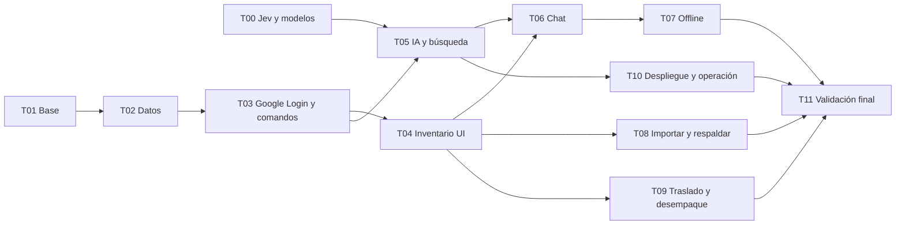

# 08 · Tareas de implementación

Cada tarea debe comenzar leyendo [SPEC.md](../../SPEC.md) y los contratos vinculados. Los IDs permiten abrir tareas futuras con un alcance concreto. Las dependencias indican contratos que deben existir, no obligación de esperar trabajo ajeno para hacer un prototipo aislado con mocks.

## Orden y dependencias

T00 y T01 pueden avanzar independientemente. T05 necesita los contratos de T03 aunque use repositorios simulados inicialmente. La publicación final de T10 se vuelve a verificar con todos los módulos antes de T11.

## T00 · Verificar Jev, Gateway y fallback

**Entradas:** [03-ia](03-ia.md), referencias oficiales y ejemplos históricos.

**Entregables:**

- Verificar modelo Jev accesible por Gateway, versión de SDK publicada y compatibilidad real de la API de decisiones.
- Definir interfaces `DecisionService` y `ExtractionService`, esquema de intenciones/propuestas y adaptadores simulables.
- Documentar precios vigentes con fuente/fecha, límites técnicos y ruta de facturación. No usar cifras anteriores como tarifas confirmadas.
- Preparar al menos 40 ejemplos con respuestas esperadas, incluidos ambiguos y casos que deben aclararse. Etiquetar manualmente; no usar al modelo como única fuente de ground truth.
- Comparar modelos generativos económicos para extracción excepcional; elegir uno y documentar resultado/costo si hay acceso real.
- Definir umbrales iniciales o mantener aclaración explícita donde no haya evidencia suficiente.

**Validación:** A09–A11, A18, A22 a nivel adaptador/evaluación. Distinguir live, mock y no ejecutado.

**Si faltan credenciales:** completar contratos, fixtures y evaluación offline; registrar exactamente qué prueba live queda pendiente. No bloquear T01–T04.

## T01 · Base de aplicación y herramientas

**Entradas:** SPEC y [04-arquitectura-api](04-arquitectura-api.md).

**Entregables:**

- Next.js App Router, TypeScript, Node 24 LTS y versiones fijadas con lockfile.
- Estructura propuesta, estilos accesibles, navegación Chat/Inventario/Mudanza y manifiesto/iconos básicos.
- `.env.example` sin secretos, con claves Supabase publicable/servidor separadas, configuración de tests y CI. Preparar dependencias compatibles de Supabase Auth/SSR para T03.
- Scripts documentados: `dev`, `build`, `lint`, `typecheck`, `test`; agregar `test:integration`, `test:e2e` y `eval:ai` cuando existan suites reales. No crear scripts de éxito vacío para simular validación.
- README con instalación reproducible y arranque. Un modo demo explícito puede usar fixtures, visualmente diferenciado.

**Validación:** build, tipos, navegación y accesibilidad básica en WebKit. Todavía no afirmar guardado compartido.

## T02 · Esquema y reglas de dominio

**Depende de:** T01.

**Entradas:** [02-datos](02-datos.md), los 17 destinos.

**Entregables:**

- Migraciones de entidades, índices, constraints, permisos/RLS y seed idempotente de ambientes.
- Participantes estables y membresías por correo/cuenta Auth, con unicidad, vinculación inicial atómica y conservación del historial al revocar acceso. Supabase administra las sesiones; no crear sesiones opacas propias.
- Estados de empaque, traslado, desempaque y archivo; entrada compuesta, cantidades opcionales y relaciones a accesorios.
- Contadores/reservas de etiquetas y revisión por mudanza con orden de commit correcto.
- Diseño transaccional de comandos, eventos, recibos e importaciones.
- Base de prueba independiente y forma reproducible de aplicar migraciones.

**Validación:** A02–A07 en PostgreSQL, incluyendo concurrencia real, suma de lotes y referencias entre mudanzas. No usar los muebles históricos como seed activo.

## T03 · Google Login, autorización, API de inventario y sincronización

**Depende de:** T02.

**Entregables:**

- Google OAuth con PKCE mediante Supabase Auth: inicio, callback, cookies/renovación desde servidor y salida local. Identidad validada por petición y autorización por membresía antes de datos o IA.
- Herramienta administrativa idempotente para autorizar/desactivar correos, consultar membresías y vincular participantes restaurados. Documentar comandos exactos en la guía; guardar la lista real en la base, fuera de Git.
- Atribución por cuenta, apodo propio editable, cambio de cuenta y rechazo de suplantación mediante campos del cliente. Separar cliente Auth y cliente de datos privilegiado; documentar configuración real de sesiones.
- Catálogo transaccional completo de comandos y validación en servidor.
- Lecturas de ficha/lista, snapshot consistente y feed de deltas con revisión.
- Reservas de etiquetas por dispositivo, límites de solicitud y recibos recuperables.
- Errores tipados, conflictos con snapshot actual, confirmaciones/propuestas y compensaciones.

**Validación:** A01, A03–A08, A13, A21, A23–A25, A27. Probar requests sin sesión, cuenta no autorizada, revocación y UUID ajenos. CI usa Auth simulado/local según la capa; registrar por separado el login real contra Google en test cuando esté configurado.

## T04 · Fichas e inventario usable sin IA

**Depende de:** T03.

**Entregables:**

- Crear cajas, bolsas, muebles/otros; editar campos y contenido; cerrar/reabrir.
- Lista, filtros, búsqueda determinista, ficha e historial.
- Cuenta/apodo actual, edición del perfil propio, unidad activa explícita, recibos y deshacer; no selector de otra persona.
- Formularios que permitan guardar descripciones libres y resolver datos faltantes.
- Estados de carga/error/pending y componentes adaptados a iPhone.

**Validación:** A02, A04, A11, A23, A24 y uso con IA deshabilitada. Los estados pendientes tienen significado real, no solo un spinner decorativo.

## T05 · Jev, búsqueda y control de costo

**Depende de:** contratos de T00 y API de T03.

**Entregables:**

- Pipeline de reglas → Jev → extracción excepcional, con adaptadores y esquemas versionados.
- Recuperación de candidatos, reranking, ampliación controlada y evidencia vigente.
- Plantillas de respuesta en español/inglés, sin llamada generativa para recibos simples.
- Reservas atómicas de presupuesto, límite total, rate limits, uso/costo por propósito y caché invalidable.
- Recuperación de mensajes duplicados/procesos interrumpidos y fallback manual.

**Validación:** A09–A11, A18, A22. Comparar contra dataset y registrar dónde Jev necesita aclaración. No ocultar el uso de un modelo generativo bajo la etiqueta Jev.

## T06 · Chat conversacional

**Depende de:** T04 y T05.

**Entregables:**

- Chat individual, contexto visible, dictado del teclado y mensajes persistidos.
- Tarjetas de resultados/recibos, aclaraciones con botones y confirmaciones de propuestas.
- Modo agregar contenido literal y cambio explícito de unidad activa.
- Comandos compuestos, idioma de respuesta y tratamiento de referencias ambiguas.
- Recuperación de respuesta después de perder conexión, sin duplicar escritura.

**Validación:** A06–A11, A22, A24 y flujo completo de dos usuarios con cajas activas diferentes.

## T07 · Offline y PWA instalada

**Depende de:** T03, T04 y T06.

**Entradas:** [05-offline-ios](05-offline-ios.md).

**Entregables:**

- IndexedDB versionado, snapshot, cola durable, dependencias y proyección local diferenciada.
- Etiquetas reservadas, borradores temporales cuando se agotan y coordinación entre tabs.
- Reanudación al primer plano, conflictos revisables y pendientes exportables.
- Service worker, instalación y actualización sin perder borradores/cola.
- Recuperación con Google de sesión no renovable, cola separada por cuenta/mudanza, salida local sin red y cambio de cuenta sin reasignar autoría.

**Validación:** A03, A12, A13, A19, A24, A26 en WebKit y posteriormente iPhone real. Probar cierre forzado entre envío y recibo, y retorno OAuth desde Safari/PWA instalada.

## T08 · Revisión de muebles y respaldo

**Depende de:** T03 y T04.

**Entradas:** [06-importacion](06-importacion.md), JSON de referencias y manifest.

**Entregables:**

- Vista previa de candidatos, exclusiones, comentarios, discrepancias y destino pendiente.
- Clasificación de muebles/otros/contenedores a reiniciar y confirmación del lote.
- Procedencia e importación idempotente reanudable, sin crear cajas históricas automáticamente.
- Exportación JSON/CSV y herramienta/procedimiento de restauración verificado en base de prueba.
- Respaldo conserva participantes/autores sin credenciales ni membresías; restauración con revinculación explícita de cuentas mediante herramienta de T03.

**Validación:** A16, A17 y A21. Datos de precio o cotización no se convierten en campos de inventario por suposición.

## T09 · Traslado, desempaque y accesorios

**Depende de:** T04 y catálogo de T03; reutiliza chat de T06 cuando esté disponible.

**Entregables:**

- Vista de mudanza por ambiente, pendientes, prioridad, carga y llegada.
- Habitación real separada del destino previsto.
- División de lotes, retiro/transferencia de contenido y relaciones con muebles.
- Desempaque parcial/terminado con búsqueda histórica correcta.

**Validación:** A14, A15, A23; comprobar que búsquedas ya no afirman presencia de objetos retirados.

## T10 · Despliegue y operación económica

**Depende de:** T01, T03 y T05; ensayar primero con las partes disponibles y repetir tras integrar las demás.

**Entregables:**

- Proyecto Vercel conectado a GitHub con previews y producción diferenciados.
- Proyecto(s) Supabase con Auth y Gateway configurados con bindings existentes cuando correspondan; clientes Google OAuth Web distintos para prod/test, scopes básicos y URLs de retorno documentadas.
- Separación de secretos/datos/presupuesto por entorno; credenciales nunca en Git.
- Migraciones y rollback documentados; métricas de errores, latencia y costo.
- Guía para autorizar correos, ingresar con Google, instalar PWA, revocar acceso sin borrar historial, exportar respaldo y comprobar que todos sincronizan.
- Origen canónico y callback de preview controlados, aislados de producción; demo explícita cuando una preview no tenga OAuth real.
- Completar y verificar la [guía de configuración de cuentas y servicios](../GUIA-CONFIGURACION.md) con rutas/comandos vigentes y datos no secretos del entorno elegido.
- Registro de límites/precios vigentes y verificación de que el plan elegido sirve al uso familiar.

**Validación:** A01, A18–A21, A25, A27 y smoke test de persistencia con dos cuentas Google reales autorizadas. La creación de recursos o publicación se hace en una tarea autorizada para ello; esta especificación no publica ni crea cuentas.

## T11 · Validación de lanzamiento

**Depende de:** T06, T07, T08, T09 y T10.

**Entregables:**

- Ejecutar escenarios A01–A27 pertinentes y evaluación de IA con resultados separados por ruta.
- Simular empaque, traslado y desempaque con 3–5 cuentas, sesiones renovadas y desconexiones.
- Verificar iPhone real, actualización de PWA y restauración de respaldo.
- Registrar limitaciones concretas, integraciones no probadas y métricas de costos/latencia.
- Resolver fallos de integridad antes de declarar el producto listo.

No ampliar esta tarea a funciones P1 para compensar fallos de v1. No esconder pruebas omitidas detrás de un build exitoso.

## Ampliaciones P1

Después de v1 y según necesidad: QR/etiquetas, fotos, transcripción propia con botón de voz, lista de últimas cosas y estructura explícita de contenedores anidados. Cada una requiere alcance y criterios propios; no agregar todas como dependencia de la primera versión.

## Prompt sugerido para abrir una tarea

> Implementá T04 de docs/specs/08-plan-implementacion.md. Leé primero SPEC.md y los contratos vinculados. Usá el checkout existente. Inspeccioná qué dependencias ya están implementadas, completá el alcance de T04, verificá sus criterios de aceptación y documentá cualquier cambio de contrato necesario. Conservá los datos históricos como referencia; no los cargues como inventario real. Reportá qué quedó probado y qué requiere integración posterior.

Cambiar T04 por el ID correspondiente. Al terminar cada tarea, actualizar el estado de avance con evidencia en el PR o documento de seguimiento, sin reescribir estas especificaciones como si todos los componentes estuvieran completos.
